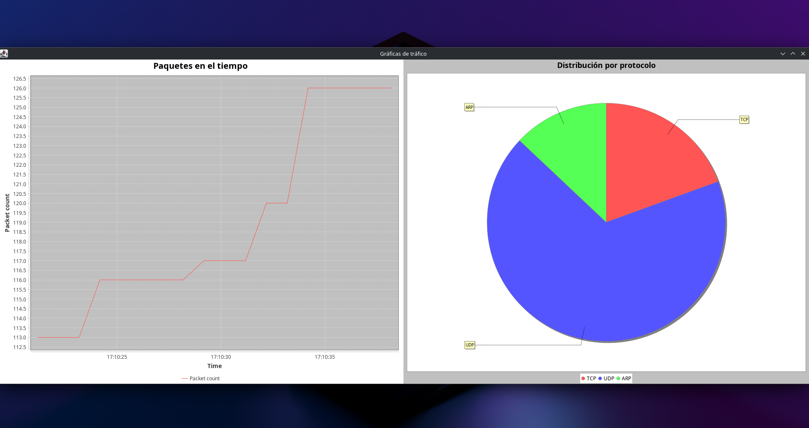

# Supervisor de Red

> [English](README.md) | [Español](README-es.md)

Visualizador de tráfico de red de escritorio para Linux, macOS y Windows.
Capture paquetes desde cualquier interfaz de red, fíltrelos con expresiones BPF (Berkeley Packet Filter)
predefinidas o personalizadas, y observe el tráfico en vivo como texto crudo de
paquetes, una gráfica de paquetes contra tiempo y una gráfica circular de
distribución de protocolos.

Desarrollado originalmente en 2015 como proyecto universitario, actualizado y entregado en 2026.



## Funcionalidades

- Listar interfaces de red con descripción, tipo de enlace, MAC (Media Access Control), IP (Internet Protocol), máscara y broadcast
- Captura con inicio/detención y vista desplazable de paquetes en crudo
- Filtros predefinidos: HTTP, HTTPS, FTP, SMTP, ICMP, ARP — más un filtro BPF libre
- Gráficas en vivo: paquetes contra tiempo y distribución de protocolos (TCP / UDP / ARP / ICMP)
- Guardar y cargar sesiones de captura
- Interfaz moderna FlatLaf (claro y oscuro), en español por defecto y con inglés disponible

## Requisitos

- Java 21 o superior
- Un backend de captura:
  - Linux: `libpcap` (normalmente preinstalada) y permisos de root o `CAP_NET_RAW`
  - macOS: permisos de root
  - Windows: [Npcap](https://npcap.com/)

## Compilar

```bash
./mvnw clean package
```

El jar ejecutable se genera en `target/supervisor-de-red-0.1.0.jar`.

## Ejecutar

```bash
java -jar target/supervisor-de-red-0.1.0.jar
```

La captura requiere los permisos indicados arriba.

## Probar

```bash
./mvnw test
```

La suite se ejecuta sin captura nativa ni privilegios de root.

## Documentación

- [Guía de usuario](docs/user-guide-es.md) — primera captura, filtros, gráficas,
  solución de problemas
- [Arquitectura](docs/architecture-es.md) — capas, seguridad del EDT (Event Dispatch Thread, hilo de despacho de eventos), mapa de paquetes
- [Pila tecnológica y estándares](docs/tech-stack-es.md) — versiones, convenciones de nombres, TDD (desarrollo guiado por pruebas)
- [Contribuir](CONTRIBUTING-es.md)
- [Registro de cambios](CHANGELOG-es.md)

## Licencia

[MIT](LICENSE) — consulte [LICENSE-es.md](LICENSE-es.md) para el texto en español.
