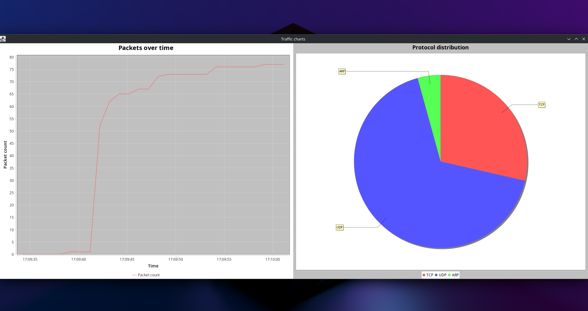

# Supervisor de Red

[](https://github.com/DaydreamsDev/supervisor-de-red/actions/workflows/ci.yml)
[](LICENSE)

> [English](README.md) | [Español](README-es.md)

Desktop network traffic visualizer for Linux, macOS, and Windows. Capture packets
from any network interface, filter them with preset or custom BPF (Berkeley Packet Filter) expressions, and
watch the traffic live as raw packet text, a packets-vs-time chart, and a protocol
distribution pie chart.

Originally developed in 2015 as a university project, updated and delivered in 2026.



## Features

- List network interfaces with description, link type, MAC (Media Access Control), IP (Internet Protocol), mask, and broadcast
- Capture with start/stop and a scrollable raw packet view
- Preset filters: HTTP, HTTPS, FTP, SMTP, ICMP, ARP — plus a free-form BPF filter
- Live charts: packets vs. time and protocol distribution (TCP / UDP / ARP / ICMP)
- Save and load capture sessions
- Modern FlatLaf interface (light and dark), Spanish UI by default with English available

## Requirements

- Java 21 or later
- A capture backend:
  - Linux: `libpcap` (usually preinstalled) and root or `CAP_NET_RAW` permission
  - macOS: root permission
  - Windows: [Npcap](https://npcap.com/)

## Run it

Download the prebuilt jar from the [latest release](https://github.com/DaydreamsDev/supervisor-de-red/releases/latest)
and start it with capture privileges:

```bash
sudo -E java -jar supervisor-de-red-0.1.1.jar
```

On Linux, `sudo -E` keeps your desktop session environment while elevating, so the
interface renders correctly. Alternatives: grant `CAP_NET_RAW` to your Java binary
and run as your user, or run as root. See the
[user guide troubleshooting](docs/user-guide.md#troubleshooting) for details.

### Build from source

```bash
./mvnw clean package
java -jar target/supervisor-de-red-0.1.1.jar
```

The shaded runnable jar is produced at `target/supervisor-de-red-0.1.1.jar`.

## Usage

1. Start the application with capture privileges (see [Run it](#run-it)).
2. Pick a network interface in the Interface panel and press **Refresh** if the list is empty.
3. Start the video or service you want to observe, press **CAPTURE**, and watch the output area and charts.

Full walkthrough: [user guide](docs/user-guide.md).

## Test

```bash
./mvnw test
```

The suite runs without native capture or root privileges.

## Contributing

Contributions are welcome. Read [CONTRIBUTING.md](CONTRIBUTING.md) first:

- Work on a `type/description` branch created from `develop` (for example `fix/filter-recovery`).
- Open a pull request against `develop` with a conventional commit title and a short list of key changes.
- All tests must pass (`./mvnw verify`).

## Documentation

- [User guide](docs/user-guide.md) — first capture, filters, charts, troubleshooting
- [Architecture](docs/architecture.md) — layers, EDT (Event Dispatch Thread) safety, package map
- [Tech stack and standards](docs/tech-stack.md) — versions, naming conventions, TDD (test-driven development)
- [Contributing](CONTRIBUTING.md)
- [Changelog](CHANGELOG.md)

## License

[MIT](LICENSE) — see [LICENSE-es.md](LICENSE-es.md) for the Spanish text.
