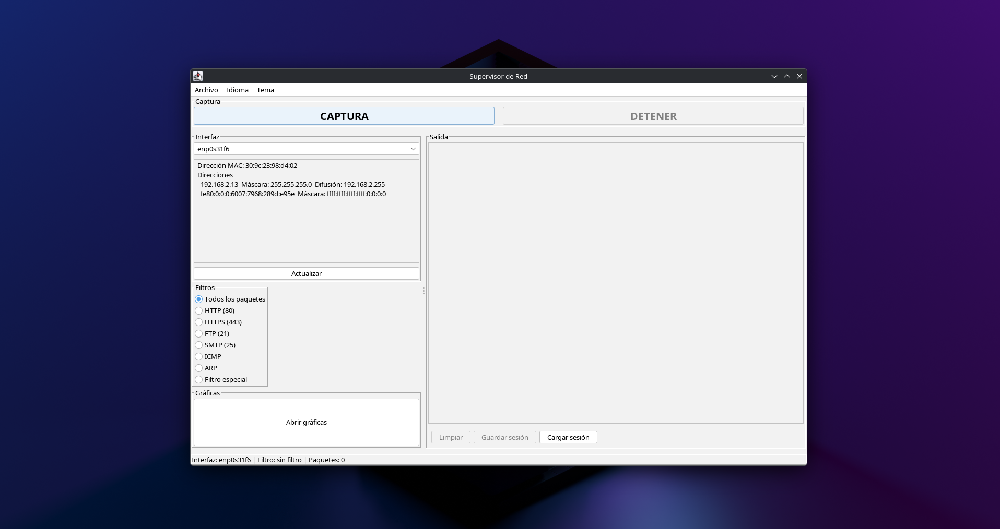

# Guía de Usuario

> [English](user-guide.md)

Supervisor de Red captura paquetes de una interfaz de red, los filtra y muestra
el tráfico en vivo como texto crudo de paquetes y gráficas. La interfaz está en
español por defecto; puede cambiarla a inglés desde el menú de idioma en
cualquier momento. A lo largo de esta guía, las etiquetas en español son las
predeterminadas.

## Requisitos

| Sistema | Backend de captura | Privilegios |
|---------|--------------------|-------------|
| Linux | `libpcap` (normalmente preinstalada) | root o `CAP_NET_RAW` |
| macOS | libpcap integrada | root |
| Windows | [Npcap](https://npcap.com/) (instálela) | driver Npcap |

Java 21 o superior en todas las plataformas.

## Compilar y ejecutar

```bash
./mvnw clean package          # compilar
java -jar target/supervisor-de-red-0.1.1.jar   # ejecutar
./mvnw test                   # probar
```

En Linux, la captura necesita `CAP_NET_RAW`. La forma recomendada es concederla una
vez al binario de Java y luego ejecutar como su usuario normal (una aplicación GUI
lanzada con `sudo` pierde el entorno de su sesión de escritorio y algunos gestores
de ventanas descolocan o cierran sus menús emergentes):

```bash
sudo setcap cap_net_raw,cap_net_admin+eip "$(readlink -f "$(command -v java)")"
java -jar target/supervisor-de-red-0.1.1.jar
```

Si no puede conceder la capacidad, `sudo -E java -jar …` conserva el entorno de su
sesión al elevar privilegios.

## Primera captura

1. Inicie la aplicación (véase [Compilar y ejecutar](#compilar-y-ejecutar)).
2. Pulse **Actualizar** en el panel de interfaz para listar los dispositivos
   de captura y elija uno en el desplegable — debajo aparecen la descripción,
   MAC (Media Access Control) y direcciones del dispositivo seleccionado.
3. Elija un dispositivo en el desplegable bajo la lista.
4. En el panel de filtros, elija un predefinido — **HTTP (80)**, **HTTPS (443)**,
   **FTP (21)**, **SMTP (25)**, **ICMP** o **ARP** — o elija el predefinido de
   **filtro especial** y escriba su propia expresión BPF (Berkeley Packet Filter) en el campo que se
   habilita.
5. Active o desactive el filtro con el conmutador de filtro.
6. Pulse **CAPTURA** (el botón grande de captura). Los paquetes empiezan a fluir
   en el área de salida y el contador de la barra de estado sube.
7. Abra la ventana de gráficas desde el panel correspondiente: la gráfica de
   paquetes contra tiempo y la circular de protocolos (TCP / UDP / ARP / ICMP)
   se actualizan en vivo.
8. Pulse **DETENER** para parar. El contador de paquetes queda en su valor final.
9. Guarde la sesión en un archivo JSON con el botón de guardar del panel de
   salida (selector de archivos). Cárguela más tarde de la misma forma.

## Recorrido por la ventana



La ventana principal agrupa los controles en paneles con borde:

| Panel | Qué hace |
|-------|----------|
| **Captura** | **CAPTURA** / **DETENER** — los botones dominantes; solo se habilitan las acciones válidas |
| **Interfaz** | **Actualizar** para listar dispositivos y seleccionar uno en el desplegable |
| **Filtros** | Filtros predefinidos, el campo BPF libre, activar/desactivar |
| **Gráficas** | Abrir la ventana de gráficas |
| **Salida** | Texto crudo de paquetes, botón de limpiar, guardar/cargar sesión |

La **barra de estado** muestra siempre el dispositivo seleccionado, el estado
del filtro y el contador de paquetes, para que no tenga que recordarlos.

## Filtros

| Predefinido | Expresión BPF |
|-------------|---------------|
| HTTP (80) | `ip and tcp and port 80` |
| HTTPS (443) | `ip and tcp and port 443` |
| FTP (21) | `port 21` |
| SMTP (25) | `port 25` |
| ICMP | `icmp` |
| ARP | `arp` |

El campo del **filtro especial** libre se habilita solo cuando ese predefinido
está seleccionado. La aplicación valida la expresión antes de iniciar la
captura; un filtro inválido se rechaza con un mensaje en lugar de fallar a
mitad de la captura.

## Gráficas

Las gráficas se abren en una **ventana secundaria** desde el panel de gráficas:

- **Paquetes contra tiempo** — serie temporal en vivo de paquetes capturados.
- **Distribución de protocolos** — gráfica circular de TCP / UDP / ARP / ICMP.

Ambas se refrescan con las mismas estadísticas que alimentan la barra de estado.

## Sesiones

- **Guardar** escribe el registro de paquetes capturados como JSON (mediante un
  selector de archivos).
- **Cargar** lee una sesión guardada previamente de vuelta al área de salida.
- Las sesiones son archivos JSON planos — portables e inspeccionables.

## Idioma y tema

- **Menú de idioma**: Español (por defecto) / English — las cadenas de la UI se
  recargan al cambiar.
- **Menú de tema**: Claro / Oscuro — FlatLaf reestiliza toda la aplicación.

## Solución de problemas

| Problema | Causa probable | Solución |
|----------|----------------|----------|
| Permiso denegado al capturar | Faltan privilegios de captura | Linux: ejecute con root o `CAP_NET_RAW`. macOS: ejecute como root. Windows: instale Npcap. |
| No se listan interfaces | Falta el backend o faltan privilegios | Windows: instale Npcap. Linux: revise `libpcap` y los privilegios. Reintente **Actualizar**. |
| Filtro BPF inválido | La expresión no pasa la validación | Use la sintaxis exacta (p. ej. `port 443`) o parta de un predefinido. |
| La captura se detiene de inmediato | Dispositivo caído o no disponible | Elija otro dispositivo y reintente. |
| Los menús se abren y cierran al instante, o aparecen lejos de la barra | Menús emergentes de Java Swing bajo XWayland, peor cuando la aplicación se ejecuta como root con `sudo` | Ejecute como su usuario con la configuración de `CAP_NET_RAW` de arriba en lugar de `sudo`. Si persiste, inicie desde una sesión X11. |
| La ventana no se expande o no maximiza correctamente | Manejo del gestor de ventanas sobre un cliente XWayland lanzado como root | Ejecute sin `sudo` (véase arriba). |

Si un error es accionable, la aplicación muestra un diálogo con la causa; los
detalles también aparecen en el registro.

## Siguiente paso

- [Arquitectura](architecture-es.md)
- [Pila tecnológica](tech-stack-es.md)
