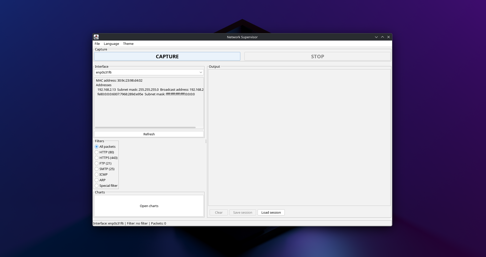

# User Guide

> [Español](user-guide-es.md)

Supervisor de Red captures packets from a network interface, filters them, and
shows the traffic live as raw packet text and charts. The interface is in
Spanish by default; switch to English from the language menu at any time.
Spanish labels appear in parentheses throughout this guide.

## Requirements

| OS | Capture backend | Privileges |
|----|-----------------|------------|
| Linux | `libpcap` (usually preinstalled) | root or `CAP_NET_RAW` |
| macOS | built-in libpcap | root |
| Windows | [Npcap](https://npcap.com/) (install it) | Npcap driver |

Java 21 or later on all platforms.

## Build and run

```bash
./mvnw clean package          # build
java -jar target/supervisor-de-red-0.1.1.jar   # run
./mvnw test                   # test
```

On Linux, capture needs `CAP_NET_RAW`. The recommended way is to grant it once to
your Java binary and then run as your normal user (a GUI app run with `sudo` loses
your desktop session environment and some compositors then misplace or close its
popup menus):

```bash
sudo setcap cap_net_raw,cap_net_admin+eip "$(readlink -f "$(command -v java)")"
java -jar target/supervisor-de-red-0.1.1.jar
```

If you cannot grant the capability, `sudo -E java -jar …` keeps your session
environment while elevating.

## First capture

1. Launch the app (see [Build and run](#build-and-run)).
2. Click **Actualizar** (*Actualizar* in both languages) in the Interface panel
   to list all capture devices, then pick one in the device dropdown — the
   selected device's description, MAC (Media Access Control), and addresses appear below.
3. Choose a device in the dropdown below the list.
4. In the Filters panel, pick a preset — **HTTP (80)**, **HTTPS (443)**,
   **FTP (21)**, **SMTP (25)**, **ICMP**, or **ARP** — or choose the **special
   filter** preset and type your own BPF (Berkeley Packet Filter) expression in the field that becomes
   enabled.
5. Enable or disable the filter with the filter toggle.
6. Press **CAPTURA** (the large capture button). Packets start streaming into
   the output area and the status bar counter climbs.
7. Open the charts window from the Charts panel: packets vs. time and the
   protocol pie (TCP / UDP / ARP / ICMP) both update live.
8. Press **DETENER** to stop. The packet count freezes at its final value.
9. Save the session to a JSON file with the save button in the Output panel
   (file chooser). Load it back later the same way.

## Window tour



The main window groups controls in bordered panels:

| Panel | What it does |
|-------|--------------|
| **Capture** | **CAPTURA** / **DETENER** — the dominant buttons; only valid actions are enabled |
| **Interface** | **Refresh** devices and select one from the dropdown |
| **Filters** | Preset filters, the free-form BPF field, enable/disable |
| **Charts** | Open the charts window |
| **Output** | Raw packet text, clear button, save/load session |

The **status bar** always shows the selected device, the filter state, and the
packet count, so you never have to remember them.

## Filters

| Preset | BPF expression |
|--------|----------------|
| HTTP (80) | `ip and tcp and port 80` |
| HTTPS (443) | `ip and tcp and port 443` |
| FTP (21) | `port 21` |
| SMTP (25) | `port 25` |
| ICMP | `icmp` |
| ARP | `arp` |

The free-form **special filter** field is enabled only when that preset is
selected. The app validates the expression before capture starts; an invalid
filter is rejected with a message instead of failing mid-capture.

## Charts

Charts open in a **secondary window** from the Charts panel:

- **Packets vs. time** — live time series of packets captured.
- **Protocol distribution** — pie chart of TCP / UDP / ARP / ICMP.

Both refresh from the same statistics that feed the status bar.

## Sessions

- **Save** writes the captured packet log as JSON (via a file chooser).
- **Load** reads a previously saved session back into the output area.
- Sessions are plain JSON files — portable and inspectable.

## Language and theme

- **Language menu**: Español (default) / English — UI strings reload on switch.
- **Theme menu**: Claro (light) / Oscuro (dark) — FlatLaf restyles the whole app.

## Troubleshooting

| Problem | Likely cause | Fix |
|---------|--------------|-----|
| Permission denied at capture | Missing capture privileges | Linux: run with root or `CAP_NET_RAW`. macOS: run as root. Windows: install Npcap. |
| No interfaces listed | Backend missing or no privileges | Windows: install Npcap. Linux: check `libpcap` and privileges. Retry **Actualizar**. |
| Invalid BPF filter | Expression rejected by validation | Use the exact syntax (e.g. `port 443`), or start from a preset. |
| Capture stops immediately | Device down or unavailable | Choose another device and retry. |
| Menus open and close instantly, or popups appear far from the menu bar | Java Swing popups under XWayland, worse when the app runs as root via `sudo` | Run as your user with the `CAP_NET_RAW` setup above instead of `sudo`. If it persists, launch from an X11 session. |
| Window does not expand or maximize correctly | Compositor handling of an XWayland client launched as root | Run without `sudo` (see above). |

If an error is actionable, the app shows a dialog with the cause; details also
appear in the log.

## Next step

- [Architecture](architecture.md)
- [Tech stack](tech-stack.md)
